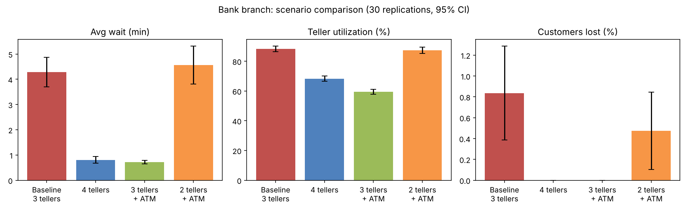

# 🏦 Bank Branch Discrete-Event Simulation

[](https://www.python.org/downloads/)
[](https://simpy.readthedocs.io/)
[](https://opensource.org/licenses/MIT)

A discrete-event simulation (DES) model built with **Python & SimPy** to analyze customer queueing behavior, teller utilization, customer balking rates, and operational efficiency across multiple branch staffing and automation configurations.

This repository serves as an analytical reference and validation benchmark model for discrete-event queueing systems.

---

## 📌 Executive Summary & Findings

In retail banking operations, customer wait times and queue lengths directly impact customer satisfaction, while overstaffing inflates operational expenditure. This simulation assesses the operational impact of introducing automated teller machines (ATMs) and adjusting teller headcounts over a 6-hour banking business day.

### Key Insights:
- **Baseline Bottleneck:** With 3 human tellers, high customer arrival bursts result in an average wait time of **4.28 minutes**, with **13.51%** of customers waiting more than 10 minutes and an **88.32%** teller utilization rate.
- **Automation Impact (Scenario 2):** Introducing **1 ATM** for routine cash withdrawals (which represent 35% of all customer traffic) dramatically reduces the average customer wait time by **83%** (down to **0.72 minutes**), eliminates customer balking entirely, and reduces teller utilization to a healthy **59.50%**.
- **Labor Optimization (Scenario 3):** Deploying **1 ATM with only 2 tellers** matches or outperforms the service levels of the 3-teller baseline while reducing teller staffing requirements by **33%**.

---

## 📊 Scenario Comparison Results

Each scenario was evaluated over **30 independent replications** with randomized seeds. Values are reported as **Mean ± 95% Confidence Interval Half-width**:

| Metric | Baseline (3 Tellers) | Scenario 1 (4 Tellers) | Scenario 2 (3 Tellers + 1 ATM) | Scenario 3 (2 Tellers + 1 ATM) |
| :--- | :---: | :---: | :---: | :---: |
| **Average Wait Time (min)** | `4.28 ± 0.59` | `0.81 ± 0.13` | **`0.72 ± 0.07`** | `4.56 ± 0.75` |
| **Average Wait at Teller (min)** | `4.28 ± 0.59` | `0.81 ± 0.13` | `0.71 ± 0.10` | `6.62 ± 1.10` |
| **P(Wait > 10 min) (%)** | `13.51 ± 4.06` | `0.08 ± 0.16` | **`0.00 ± 0.00`** | `17.92 ± 4.70` |
| **Max Wait Time (min)** | `14.95 ± 1.33` | `6.65 ± 0.82` | `6.52 ± 0.46` | `21.07 ± 2.01` |
| **Average Queue Length** | `2.78 ± 0.41` | `0.54 ± 0.09` | **`0.30 ± 0.04`** | `2.84 ± 0.55` |
| **Max Queue Length** | `10.37 ± 0.84` | `6.03 ± 0.72` | `4.37 ± 0.44` | `9.93 ± 0.85` |
| **Customer Balking (%)** | `0.84 ± 0.45%` | **`0.00%`** | **`0.00%`** | `0.47 ± 0.37%` |
| **Teller Utilization (%)** | `88.32 ± 1.86%` | `68.32 ± 1.81%` | `59.50 ± 1.67%` | `87.26 ± 2.15%` |
| **ATM Utilization (%)** | *N/A* | *N/A* | `41.94 ± 1.72%` | `41.25 ± 1.61%` |
| **Total Customers Served** | `233.93 ± 5.08` | `237.77 ± 5.74` | `239.10 ± 5.86` | `238.30 ± 5.91` |
| **Branch Overtime (min)** | `7.79 ± 1.64` | `3.89 ± 0.81` | `4.21 ± 0.76` | `10.18 ± 2.94` |

---

## 📈 Visual Performance Comparison



---

## ⚙️ Model Architecture & System Parameters

The discrete-event simulation operates on a continuous time horizon with the following stochastic specifications:

| Parameter | Specification | Details / Statistical Distribution |
| :--- | :--- | :--- |
| **Branch Operating Hours** | 6 Hours (360 min) | Doors close at $T = 360$; any customers queued inside are served to completion. |
| **Customer Arrivals** | Poisson Process | $\lambda = 40\text{ arrivals/hour}$ (Exponential inter-arrival times, mean = $1.5\text{ min}$). |
| **Service Needs** | Categorical Split | $35\%$ cash-withdrawal only (ATM eligible); $65\%$ full-service teller transactions. |
| **Teller Service Duration** | Triangular Distribution | $\text{Triangular}(\min=2.0, \text{mode}=3.5, \max=7.0)\text{ min}$ (Mean: $4.17\text{ min}$). |
| **ATM Service Duration** | Triangular Distribution | $\text{Triangular}(\min=1.0, \text{mode}=1.5, \max=3.0)\text{ min}$ (Mean: $1.83\text{ min}$). |
| **Customer Balking Limit** | Queue Capacity Threshold | Arriving customers abandon the branch if the teller queue length is $\ge 12$. |
| **Queueing Discipline** | Single FIFO Queue | Single waiting line served by the next available teller resource. |

---

## 🚀 Getting Started

### Prerequisites

Ensure you have Python 3.9 or higher installed:

```bash
python --version
```

### Installation

1. **Clone the repository:**
   ```bash
   git clone https://github.com/samatgamal/Bank_Simulation_Project.git
   cd Bank_Simulation_Project
   ```

2. **Create a virtual environment (optional but recommended):**
   ```bash
   python -m venv venv
   # Windows:
   venv\Scripts\activate
   # macOS/Linux:
   source venv/bin/activate
   ```

3. **Install required dependencies:**
   ```bash
   pip install -r requirements.txt
   ```

### Running the Simulation

Execute the simulation script:

```bash
python bank_sim.py
```

The script will:
1. Run 30 independent replications across all 4 operational scenarios.
2. Compute sample means and 95% Student's t confidence intervals.
3. Export detailed statistical summaries to `results.csv`.
4. Generate the comparative analysis chart and save it as `scenario_comparison.png`.

---

## 📁 Repository Structure

```plaintext
Bank_Simulation_Project/
├── bank_sim.py                           # Core SimPy discrete-event simulation model
├── results.csv                           # Output dataset of all runs and 95% CIs
├── scenario_comparison.png               # Generated performance comparison chart
├── Bank Branch Simulation - Project Report.docx  # Detailed project report
├── requirements.txt                      # Project Python dependencies
├── .gitignore                            # Git ignore configuration
└── README.md                             # Project documentation and summary
```

---

## 👤 Author

Developed by **[Sama Tamer](https://github.com/samatgamal)**
